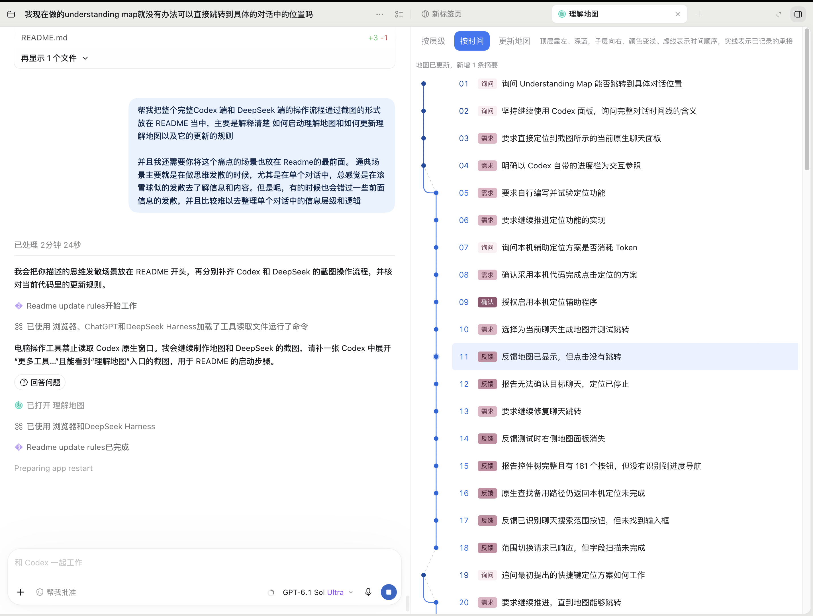
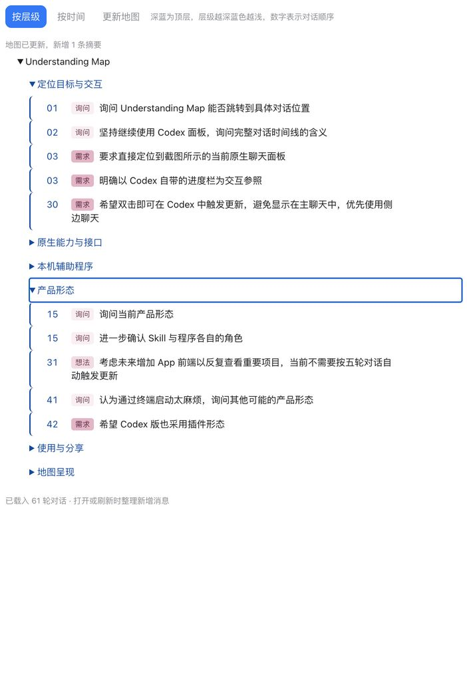
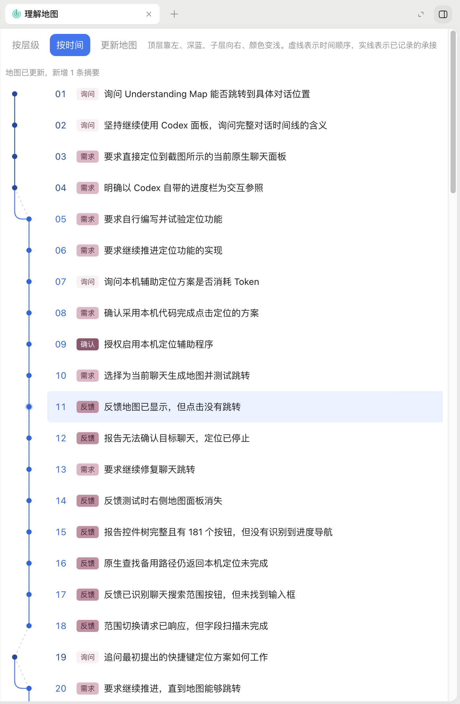
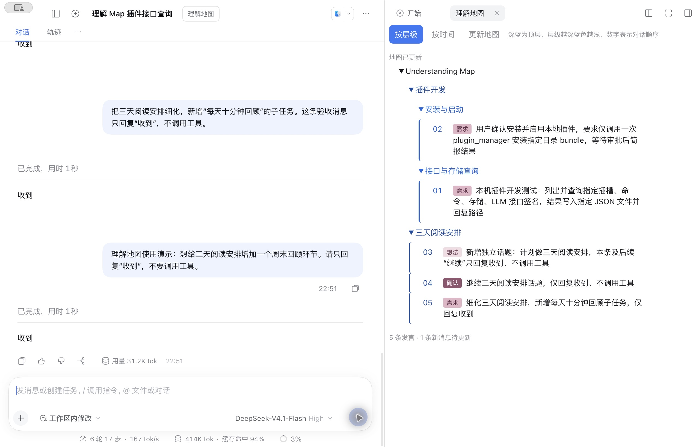
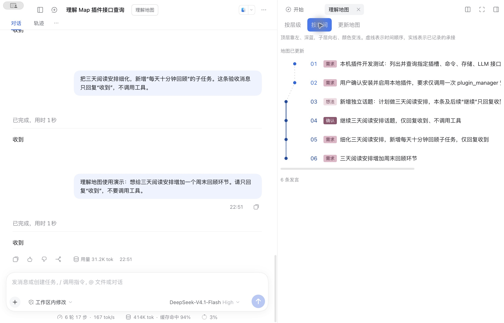

# Understanding Map

做思维发散时，单个对话里的信息常常像滚雪球一样越积越多。沿着一个问题继续追问，很容易错过前面还值得展开的分支。等到想回头整理，又很难理清这段对话的信息层级和逻辑。

Understanding Map 在聊天旁把你的每次发言整理成简短摘要，按话题层级或时间顺序展示。你可以回顾已经走过的思路，找到还想继续追问的分支，再点击摘要回到原文，接着讨论。

目前提供 Codex 桌面本地插件和独立的 DeepSeek Harness 原生插件。两端都在聊天右侧显示地图，支持“按层级”“按时间”、增量更新和点击原文定位。

[Codex 图文流程](#在-codex-中使用) · [DeepSeek 图文流程](#在-deepseek-harness-中使用) · [更新规则](#地图如何更新)

## 下载

| 使用环境 | 当前版本 | 下载文件 | 安装说明 |
| --- | --- | --- | --- |
| Codex 桌面版 | `0.4.5` 测试版 | [Understanding-Map-Codex-0.4.5.zip](https://github.com/dickens2685477697-dotcom/Understanding-Map/releases/download/v0.4.5/Understanding-Map-Codex-0.4.5.zip) | 包内 `START-HERE.md` 或附件 `START-HERE-Codex.md` |
| DeepSeek Harness | `0.3.2` 测试版 | [Understanding-Map-DeepSeek-0.3.2.zip](https://github.com/dickens2685477697-dotcom/Understanding-Map/releases/download/v0.4.3/Understanding-Map-DeepSeek-0.3.2.zip) | 包内 `START-HERE.md` 或附件 `START-HERE-DeepSeek.md` |

安装包各附有 SHA-256 校验文件和安装说明。当前仓库为私有，GitHub 下载需要仓库访问权限，也可以直接向接收者分享原始 ZIP。[Codex 0.4.5 Release](https://github.com/dickens2685477697-dotcom/Understanding-Map/releases/tag/v0.4.5) · [DeepSeek 0.3.2 所在 Release](https://github.com/dickens2685477697-dotcom/Understanding-Map/releases/tag/v0.4.3)

截图来自 macOS 桌面版，点击可查看原图。

## 在 Codex 中使用

### 安装插件并重启

准备 Codex 桌面版、Node.js 20+、Python 3.9+，并确保 Codex CLI 已用自己的账号登录或配置 API。Mac 使用 `python3`，Windows 支持 `py -3`、`python` 或 `python3`。Mac 原文定位辅助程序面向 Apple Silicon 和 macOS 15+，首次使用需要授予辅助功能权限。

下载 Codex ZIP，解压完整的 `Understanding-Map-Codex-0.4.5` 文件夹，放到准备长期保留的位置。在该文件夹打开终端或 PowerShell，执行以下两条命令。

```sh
codex plugin marketplace add .
codex plugin add understanding-map@understanding-map-local
```

如果 Mac 终端找不到 `codex`，默认位置的桌面应用通常附带 CLI，可使用下面的命令。

```sh
"/Applications/ChatGPT.app/Contents/Resources/codex-cli/bin/codex" plugin marketplace add .
"/Applications/ChatGPT.app/Contents/Resources/codex-cli/bin/codex" plugin add understanding-map@understanding-map-local
```

安装完成后，完全退出并重新打开 Codex。Mac 使用 `⌘Q`。从旧版升级时，先完全退出 Codex，在新版解压目录重新执行上面两条安装命令，再重开应用。

安装一次后，日常打开地图、切换视图和更新都可在聊天内完成。

### Windows 首次启动排查

安装或更新运行环境后，完整退出 Codex 的所有窗口，再重新打开。在 PowerShell 中检查以下命令。

```powershell
node --version
py -3 --version
codex --version
```

Node.js 应为 20+，Python 应为 3.9+。`py -3` 不可用时可检查 `python --version` 或 `python3 --version`。插件会检测可用的 Python，并固定使用 UTF-8 传递中文与表情。

如果依然失败，请提供地图内的完整错误文字。新版会区分 Python 缺失、版本不足、Codex CLI 启动失败和插件后台连接中断。

### 摘要任务超时

“摘要任务超时”来自模型生成阶段，说明地图后台已在运行。首次整理长对话、模型生成较慢或独立 CLI 的连接等待都可能触发超时。

0.4.4 将历史整理分成每批最多 16 条，每批校验后立即保存，单批等待上限为 5 分钟。已经完成的批次会显示在地图中，点击“更新地图”可继续处理剩余内容。模型返回明确错误时，会显示连接失败、认证失败或额度受限等具体提示。

如果仍超时，可在同一台 Windows 电脑的 PowerShell 中检查独立 CLI 是否能回复。

```powershell
codex exec --ephemeral --skip-git-repo-check --sandbox read-only "只回复 OK，不调用任何工具"
```

该检查会使用自己的模型额度。把完整错误提示和该检查结果一起提供，便于核对 CLI 登录、模型配置和连接状况。

### Windows 点击后出现空查找框

0.4.5 更新了 Windows 原文定位组件，支持直接识别已有的聊天查找输入框，兼容范围按钮隐藏的界面。若旧版点击摘要只打开查找框，请安装新版并完整退出 Codex 的所有窗口，再重开聊天和地图后点击摘要。此路径仍需 Windows 实机确认，定位失败时地图会显示简短原因。

### 打开当前聊天的理解地图

进入你想整理的聊天，打开右侧工具区，选择“更多工具… → 理解地图”。地图会绑定当前聊天，并在面板首次加载时检查历史发言，生成该聊天的地图。

<a href="docs/screenshots/codex-side-panel.png"></a>

启动后的 Codex 原生聊天与右侧理解地图。

### 切换视图和回到原文

- 点击“按层级”，按话题与子话题回顾这段对话。
- 点击“按时间”，按每次发言的原始顺序回顾思路。
- 点击摘要，地图会请求定位当前 Codex 原生聊天中的对应原文。

蓝色深浅和横向缩进表示话题的包含层级。Codex 时间视图按发言顺序编号，层级视图按原对话轮次标注，灰玫瑰色标签表示这次发言的主要意图。

<a href="docs/screenshots/codex-outline.png"></a>

### 发送新消息后更新

继续在原生聊天中交流后，点击地图顶部的“更新地图”。工具先检查新消息，再为需要处理的内容生成摘要。更新期间，按钮和状态栏会显示进度。

完成后，状态栏会显示“地图已更新，新增 N 条摘要”。旧地图补齐标签时会显示补齐数量。内容已齐全时显示“已检查，暂无新增用户消息”。

<a href="docs/screenshots/codex-update-complete.png"></a>

面板真正重新加载或页面刷新时，也会发起一次更新检查。面板持续打开时，后台每 2.5 秒读取保存结果和正在运行任务的状态。发送新消息后，使用“更新地图”即可主动整理最新内容。

## 在 DeepSeek Harness 中使用

### 安装插件并启用

准备支持本地插件的 DeepSeek Harness，并选择可用的模型与供应商。下载 DeepSeek ZIP，解压完整的 `Understanding-Map-DeepSeek-0.3.2` 文件夹，放到准备长期保留的位置。

在 Harness 中，请助手使用原生 `plugin_manager` 工具安装。将 `target` 换成自己电脑上解压目录的完整绝对路径。

```json
{"action":"install_bundle","target":"/absolute/path/to/Understanding-Map-DeepSeek-0.3.2"}
```

通过 Harness 的安装审批，根据插件管理器提示启用插件并重新启动 Harness。从旧版升级时，对新版目录执行同一安装命令，再按提示完成更新和重启。链接安装需要长期保留插件目录。

### 从聊天标题栏启动地图

打开你想整理的聊天，在聊天标题栏点击“理解地图”，右侧会打开地图面板。面板首次挂载时检查该聊天的用户发言，并生成地图。

<a href="docs/screenshots/deepseek-start.png"></a>

地图同样提供“按层级”和“按时间”两种视图。保持原生“对话”视图打开，点击摘要可以补载所需历史，并定位对应的用户原文。

### 查看待更新消息并更新

继续发言后，地图底部会提示“X 条新消息待更新”。这表示聊天中出现了尚未整理的用户发言。

<a href="docs/screenshots/deepseek-pending.png"></a>

点击顶部“更新地图”，按钮会显示“正在更新…”。完成后，状态栏显示“地图已更新”，发言数量随结果更新。内容已齐全时显示“已是最新”。

<a href="docs/screenshots/deepseek-updated.png"></a>

这次更新为新发言生成了“三天阅读安排增加周末回顾环节”的短标题，先前已保存的摘要继续复用。

DeepSeek 会保留已挂载的地图面板。面板隐藏后再次显示时，可以继续查看已保存的内容。想检查最新发言时，点击“更新地图”。

## 地图如何更新

### 每次更新会做什么

1. 读取当前聊天的用户发言，与已保存的消息 ID 对照。
2. 找出新增发言，以及旧节点需要补齐的标签或分类。
3. 有待处理内容时调用模型，生成新增摘要或补齐缺失字段。
4. 校验结果并保存，再把最新地图显示到右侧。

首次整理覆盖当前聊天中可读取的历史用户发言。后续增量更新复用已有摘要、话题与原文定位标识，只处理新增发言和缺失字段。DeepSeek 的精简标题提示词用于新生成的摘要，已有摘要继续复用。

### 哪些操作会触发检查

| 操作 | Codex | DeepSeek Harness |
| --- | --- | --- |
| 首次加载地图面板 | 自动检查并整理历史 | 自动检查并整理历史 |
| 点击“更新地图” | 检查并处理新增发言、缺失意图标签 | 检查并处理新增发言、缺失话题或意图标签 |
| 页面真正刷新、面板重新加载 | 加载时自动检查 | 面板重新挂载时自动检查 |
| 已挂载面板隐藏后再显示 | 宿主复用页面时可继续查看现有地图，点击“更新地图”检查最新内容 | 保留现有地图，点击“更新地图”检查最新内容 |
| 地图持续打开时收到新发言 | 点击“更新地图”开始整理 | 底部显示待更新数量，点击“更新地图”开始整理 |
| 内容已齐全时点击更新 | 直接复用保存结果，显示“暂无新增用户消息” | 直接复用保存结果，显示“已是最新” |

### 模型用量和结果保留

- 新增发言的摘要生成、旧节点的标签或分类补齐会使用模型额度。
- 没有新增消息且所需字段齐全时，检查会跳过模型调用，复用已保存地图。
- 切换视图、折叠话题、读取已保存结果和点击原文定位使用本机数据与界面。
- Codex 使用每位使用者自己的 Codex CLI 登录或 API 配置，通过独立摘要任务生成结果。
- DeepSeek 使用当前 Harness 会话选择的模型与供应商。
- 更新过程中重复触发同一聊天的更新，会复用正在运行的任务。失败后可再次点击“更新地图”重试。

<details>
<summary>查看两端更新实现与失败保存规则</summary>

### Codex

从当前聊天末尾向前读取历史，每页最多 50 轮。首次读取会继续向前翻页。已有地图的后续检查遇到已保存且完成的轮次时停止向前读取，再按消息 ID 找出新增用户发言。

新增消息与缺少意图标签的旧节点分批处理，每批最多 16 条。每批摘要任务使用独立的 `codex exec --ephemeral`，读取 CLI 的登录和模型配置。辅助上下文使用最近最多 100 个摘要节点及 6 条消息，每条上下文最多 2000 字。原始待总结发言完整保留。

原生聊天的用户文字与 AI 最终回复可作为上下文和导航信息保存，地图为用户发言生成摘要节点。旧节点补齐意图时复用原摘要、话题与承接关系。当前 Codex 补齐流程按缺失意图字段触发。

每批结果通过消息覆盖、唯一性、合法意图、话题和先后关系校验后，立即写入本地状态并发布地图文件。后续批次超时或失败时，已完成批次保留，再次更新会继续处理剩余内容。更新使用同聊天任务复用和文件锁，防止并发修改。

面板每 2.5 秒的轮询读取已保存的地图文件与当前任务状态。页面加载和“更新地图”按钮负责发起新的整理检查。

### DeepSeek Harness

从 Harness 当前聊天的用户消息事件投影读取文字，按消息 ID 去重。没有文字的消息目前记为“[附件消息]”。

先补齐旧节点缺失的话题或意图字段，再生成新消息摘要，每批最多处理 16 条。每批带入已有话题与最近最多 100 个节点作为上下文，模型使用当前会话选择的供应商与模型。

每一批结果校验通过后立即保存。如果后续批次失败，之前成功的批次已经保存，再次更新会继续处理尚未保存的消息。更新过程复用同聊天的正在运行任务。

面板首次挂载或绑定的聊天变化时发起检查。已挂载面板会保留状态，待更新数量随聊天消息投影变化。新一轮整理由“更新地图”触发。

</details>

## 如何阅读地图

“按层级”按话题的包含关系组织内容，适合寻找分支和继续追问。“按时间”按发言顺序呈现思路变化，灰色虚线连接时间顺序，蓝色实线连接有依据的消息承接。顶层话题靠左、深蓝，子层向右、蓝色变浅。

每条摘要对应一次用户发言，标签结合上下文表达当时的主要意图。

| 标签 | 含义 |
| --- | --- |
| 询问 | 获取信息或理解原因 |
| 想法 | 提出可继续讨论的设想 |
| 需求 | 希望执行、实现或修改 |
| 反馈 | 报告结果、问题或体验 |
| 确认 | 同意、选择、确认或授权 |

承接前面设想的“开始做”会按需求理解，先前设想保留当时的想法标签。

## 兼容性与验证范围

- Codex `0.4.5` 包含五类意图标签、灰玫瑰配色、日常与开发模式及原文定位兼容修复。macOS 已验证侧边打开、刷新更新、重启恢复和旧连接自动重连。
- macOS 导航辅助程序的较长消息和短用户消息跳转已实测成功。短消息通过同轮回复的唯一片段定位上下文，其他电脑上的原生跳转仍需验证。
- Windows UI Automation 辅助程序已交叉编译并通过纯协议检查，Windows 原生界面跳转仍待实机验证。
- Codex 插件包已验证解压后的独立启动、Python 后台读取、侧边入口声明及隔离安装。Mac 测试包使用本地签名。
- DeepSeek Harness `0.3.2` 包含相同的意图标签与配色，并优化了摘要提示词。本次已在 macOS 原生 Harness 中实测旧地图标签补齐、5→6 条发言增量更新、新摘要短标题和点击原文定位，截图来自这次操作。此前已在 macOS Harness `0.2.2-rc.1` 实测层级与时间视图及重启恢复。Windows、英文界面、超长历史分页和附件单独消息仍需实机验收。详见 [DeepSeek 说明](deepseek-harness/README.md)。

## 数据保存与分享

Codex 个人地图和保存的聊天原文位于各自电脑的 `~/.understanding-map`。DeepSeek 地图由 Harness Storage Domain 按聊天保存。两端都按聊天分别管理地图。

安装包按程序文件白名单构建。分享时转发 Release 中的原始 ZIP 和对应安装说明，接收者使用自己的模型登录或 API 配置。当前私有仓库的页面和附件下载需要仓库访问权限。

开发实验使用的 `validation/understanding-map-private/`、访问令牌、聊天状态、依赖缓存和编译产物均由 `.gitignore` 排除。

## 原有 Skill 与本机服务版本

`0.2.0-test.1` 提供 Skill 与双击启动程序，按附件中的 `START-HERE.txt` 安装和启动。[打开旧版 Release](https://github.com/dickens2685477697-dotcom/Understanding-Map/releases/tag/v0.2.0-test.1)

对应源码说明见 [START-HERE.txt](validation/understanding-map/distribution/START-HERE.txt)。

## 代码结构

| 目录 | 内容 |
| --- | --- |
| `codex-plugin/` | Codex MCP 插件、嵌入式地图、恢复连接和 Release 打包 |
| `.agents/plugins/marketplace.json` | 构建后用于本地安装的 Codex 插件来源配置 |
| `deepseek-harness/` | DeepSeek Harness 原生插件及验证代码 |
| `docs/screenshots/` | README 中的实际界面截图 |
| `validation/understanding-map/` | 理解地图、本地服务和验证代码 |
| `validation/understanding-map/skill-draft/understanding-map/` | Skill 工作流与状态管理脚本 |
| `validation/understanding-map/native-helper/` | macOS Swift 导航辅助程序源码 |
| `validation/understanding-map/distribution/` | 跨平台安装、启动、打包及 Windows C# 适配 |
| `src/` | 早期 ChatGPT 浏览器扩展原型 |

## 开发和验证

在仓库根目录执行以下命令。

```sh
npm ci
npm test
npm run build
python3 -m unittest discover -s validation/understanding-map -p 'test_*.py'
python3 -m unittest discover -s validation/understanding-map/skill-draft/understanding-map/scripts -p 'test_*.py'
```

构建 Mac 本机辅助程序需要 Xcode Command Line Tools。

```sh
sh validation/understanding-map/native-helper/build_helper.sh
```

跨平台测试包的构建还需要 Mono，以及 Microsoft .NET Framework 4.8 的 UI Automation 引用程序集。引用程序集可以从 Microsoft 官方 NuGet 包 `Microsoft.NETFramework.ReferenceAssemblies.net48` 中获取，解压后使用包含 `UIAutomationClient.dll`、`UIAutomationTypes.dll` 和 `WindowsBase.dll` 的目录。

```sh
python3 validation/understanding-map/distribution/build_release.py --net48-refs /path/to/references
python3 validation/understanding-map/distribution/test_distribution.py
```

构建产物位于 `validation/understanding-map/releases/`。

### 构建 Codex 插件包

插件构建使用当前 Swift 源码生成 macOS 定位辅助程序，并复用 `0.2.0-test.1` Release 中的 Windows 辅助程序。准备该附件后，在 `codex-plugin` 目录执行构建与打包，详细命令见 [插件开发说明](codex-plugin/README.md)。发布产物位于 `codex-plugin/releases/`。

### 开发模式

Codex 日常模式点击节点直接定位。开发模式提供原文检查、复制与详细诊断，构建时使用 `UNDERSTANDING_MAP_DEBUG=1 npm run build`。独立本机页面可添加 `?debug=1`。`npm run package` 生成日常模式安装包。

### 早期浏览器扩展

早期浏览器扩展通过 `Structure` 操作读取选中的 ChatGPT 回复，并使用用户配置的 OpenAI API Key 调用 Responses API。该密钥由扩展保存在 `chrome.storage.local`。
